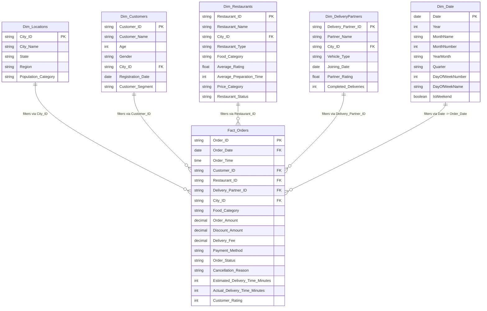

# Data Model Architecture & Star Schema Design

This document details the relational architecture, dimensional modeling principles, relationship cardinality, and storage optimization choices for the **Food Delivery & Restaurant Performance Analytics Dashboard**.

---

## 1. Architectural Philosophy: Why Star Schema?

In enterprise Business Intelligence and high-performance Power BI reporting, dimensional modeling follows Ralph Kimball's **Star Schema** standard. 

### Why Star Schema Outperforms Flat (Denormalized) Tables:
1. **VertiPaq Engine Compression:** Power BI uses a columnar, in-memory analytical engine called **VertiPaq**. Storing repeated text strings (such as customer names, city states, and restaurant categories) across 18,000 order rows causes dictionary bloat and sluggish performance. By normalizing dimensional attributes into dedicated dimension tables, integer surrogate keys are stored in the fact table, maximizing columnar Run-Length Encoding (RLE) and Bit-Packing compression.
2. **Grain Integrity & Metric Consistency:** Storing customer registration dates or restaurant preparation benchmarks inside the orders table risks grain confusion (e.g., aggregating customer counts by summing rows instead of counting distinct IDs).
3. **DAX Simplicity & Performance:** Filter propagation naturally flows from the 1-side (Dimensions) to the *-side (Fact table). Time intelligence functions (such as `SAMEPERIODLASTYEAR`, `DATESYTD`) strictly require a dedicated, contiguous calendar dimension table to calculate correct offsets.

### Why Avoid Snowflake Normalization Here:
Snowflaking (e.g. separating `Locations` out of `Restaurants` and `Customers`, then joining them hierarchically) introduces multiple table hops, increases memory pointer overhead, and makes DAX filter context navigation unnecessarily complex. In this model, `Locations` connects directly to `Orders` via `City_ID`, preserving a pure Star Schema topology.

---

## 2. Visual Entity-Relationship Diagram (ERD)



---

## 3. Relationship Cardinality & Filter Propagation

Every relationship in this model is configured as **One-to-Many (`1:*`)** with **Single Direction (`Dim` $\rightarrow$ `Fact`)** cross-filtering.

| Primary Table (Dimension - `1`) | Join Key (`PK`) | Foreign Table (Fact - `*`) | Join Key (`FK`) | Cardinality | Cross-Filter Direction | Security / Filter Behavior |
|---|---|---|---|---|---|---|
| **`Dim_Locations`** | `City_ID` | **`Fact_Orders`** | `City_ID` | `1 : *` (One to Many) | **Single** (`Locations` filters `Orders`) | Selecting a City slices all sales, delivery times, and order counts. |
| **`Dim_Customers`** | `Customer_ID` | **`Fact_Orders`** | `Customer_ID` | `1 : *` (One to Many) | **Single** (`Customers` filters `Orders`) | Selecting a Segment or Age Bracket slices order facts cleanly. |
| **`Dim_Restaurants`**| `Restaurant_ID` | **`Fact_Orders`** | `Restaurant_ID` | `1 : *` (One to Many) | **Single** (`Restaurants` filters `Orders`) | Slicing by Restaurant Type or Cuisine filters transaction metrics. |
| **`Dim_DeliveryPartners`**| `Delivery_Partner_ID` | **`Fact_Orders`** | `Delivery_Partner_ID` | `1 : *` (One to Many) | **Single** (`Partners` filters `Orders`)| Slicing by Vehicle Type filters courier logistics performance. |
| **`Dim_Date`** | `Date` | **`Fact_Orders`** | `Order_Date` | `1 : *` (One to Many) | **Single** (`Date` filters `Orders`) | Drives standard and advanced Time Intelligence (MoM, YoY). |

### Strict Modeling Guardrails:
> [!WARNING]
> **Avoid Bi-Directional Cross-Filtering:**  
> Never change cross-filter direction to "Both" unless solving an explicit, specialized multi-fact bridge requirement. In a star schema, bi-directional filtering introduces ambiguous filter paths, increases query execution cost exponentially, and causes unpredictable measure totals.
> 
> **Avoid Many-to-Many Relationships:**  
> All dimension tables have verified unique primary keys (`ID` fields), ensuring zero many-to-many relationship warnings in Power BI Desktop.

---

## 4. Date Dimension Generation (`Dim_Date`)

A robust Date dimension is required to power Time Intelligence calculations (e.g. Month-over-Month growth, Year-to-Date revenue). Power BI's automatic date/time hierarchy creates hidden internal tables that inflate file size and should be disabled in Options.

### Option A: DAX Calculated Table (Recommended)
In Power BI Desktop, click **Modeling** > **New Table** and paste:

```dax
Dim_Date = 
VAR MinDate = DATE(2024, 1, 1)
VAR MaxDate = DATE(2024, 12, 31)
RETURN
    ADDCOLUMNS(
        CALENDAR(MinDate, MaxDate),
        "Year", YEAR([Date]),
        "Year_Month_Key", FORMAT([Date], "YYYYMM"),
        "Month_Name", FORMAT([Date], "MMMM"),
        "Month_Short", FORMAT([Date], "MMM"),
        "Month_Number", MONTH([Date]),
        "Quarter", "Q" & FORMAT([Date], "Q"),
        "Quarter_Year", "Q" & FORMAT([Date], "Q") & " " & YEAR([Date]),
        "Day_Of_Month", DAY([Date]),
        "Day_Of_Week_Number", WEEKDAY([Date], 2), -- 1 = Monday, 7 = Sunday
        "Day_Of_Week_Name", FORMAT([Date], "dddd"),
        "Day_Of_Week_Short", FORMAT([Date], "ddd"),
        "Is_Weekend", IF(WEEKDAY([Date], 2) >= 6, "Weekend", "Weekday"),
        "Is_Weekend_Flag", IF(WEEKDAY([Date], 2) >= 6, 1, 0)
    )
```

### Option B: Power Query M Script Alternative
If you prefer building the Date dimension directly in Power Query:

```powerquery-m
let
    StartDate = #date(2024, 1, 1),
    EndDate = #date(2024, 12, 31),
    TotalDays = Duration.Days(Duration.From(EndDate - StartDate)) + 1,
    DatesList = List.Dates(StartDate, TotalDays, #duration(1, 0, 0, 0)),
    #"Converted to Table" = Table.FromList(DatesList, Splitter.SplitByNothing(), {"Date"}, null, ExtraValues.Error),
    #"Changed Type" = Table.TransformColumnTypes(#"Converted to Table",{{"Date", type date}}),
    #"Added Year" = Table.AddColumn(#"Changed Type", "Year", each Date.Year([Date]), Int64.Type),
    #"Added Month" = Table.AddColumn(#"Added Year", "Month_Number", each Date.Month([Date]), Int64.Type),
    #"Added Month Name" = Table.AddColumn(#"Added Month", "Month_Name", each Date.MonthName([Date]), type text),
    #"Added Month Short" = Table.AddColumn(#"Added Month Name", "Month_Short", each Date.ToText([Date], "MMM"), type text),
    #"Added YearMonth" = Table.AddColumn(#"Added Month Short", "Year_Month_Key", each Date.ToText([Date], "yyyyMM"), type text),
    #"Added Quarter" = Table.AddColumn(#"Added YearMonth", "Quarter", each "Q" & Text.From(Date.QuarterOfYear([Date])), type text),
    #"Added DayOfWeekNumber" = Table.AddColumn(#"Added Quarter", "Day_Of_Week_Number", each Date.DayOfWeek([Date], Day.Monday) + 1, Int64.Type),
    #"Added DayOfWeekName" = Table.AddColumn(#"Added DayOfWeekNumber", "Day_Of_Week_Name", each Date.DayOfWeekName([Date]), type text),
    #"Added IsWeekend" = Table.AddColumn(#"Added DayOfWeekName", "Is_Weekend", each if Date.DayOfWeek([Date], Day.Monday) >= 5 then "Weekend" else "Weekday", type text)
in
    #"Added IsWeekend"
```

### Essential Date Table Configuration Step:
> [!IMPORTANT]
> In Power BI Desktop Model View, select `Dim_Date`, click the **Table tools** ribbon, and select **Mark as Date Table**. Choose the `Date` column as the unique identifier. Sort `Month_Name` and `Month_Short` by the numeric `Month_Number` column to ensure chronological ordering in charts.

---

## 5. Storage & Performance Optimization Summary

1. **Surrogate Key Invisibility:** Hide foreign key columns (`Orders[Customer_ID]`, `Orders[Restaurant_ID]`, `Orders[City_ID]`, `Orders[Delivery_Partner_ID]`) from Report View so users only slice using dimension table attributes.
2. **Dedicated Measure Table:** Store all DAX measures in an isolated, top-level table named `_Measures` for clean report maintenance.
3. **Format Strings Pre-applied:**
   - Currency: Currency format (`₹#,##0` or `₹#,##0.00`).
   - Counts: Whole Number (`#,##0`).
   - Percentages: Percentage format (`0.0%` or `0.00%`).
   - Ratings: Decimal Number (`0.0` or `0.00`).
